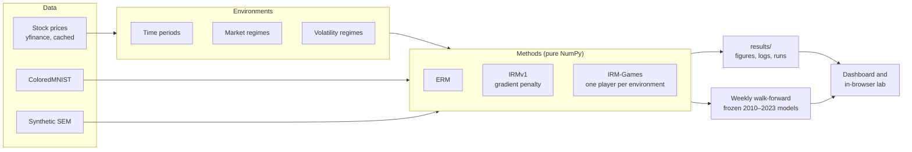

<div align="center">

# IRM Stock Prediction

**Can invariant learning ignore spurious signals in financial data?**

ERM vs. IRMv1 vs. IRM-Games, written from scratch in NumPy with hand-written gradients, tested on stock data, ColoredMNIST and a synthetic causal model, and scored every week on live markets.

[**Live site →**](https://juyal-devashish.github.io/IRM_Stock_Prediction/) &nbsp;·&nbsp; [How it works](#how-it-works) &nbsp;·&nbsp; [What's on the site](#whats-on-the-site) &nbsp;·&nbsp; [Run it](#run-it)


</div>

## How it works, in one page

- **The problem:** a model trained by ordinary empirical risk minimization (ERM) happily learns any feature that predicts the label in its training data, including **spurious** ones whose relationship to the label changes when the market changes. Those shortcuts break out of sample.
- **What this does:** it trains ERM, **IRMv1** and **IRM-Games** side by side on tasks where a spurious feature's link to the label shifts across environments (time periods, market regimes, volatility regimes), and measures which methods hold up when the environment changes.
- **How it's checked:** the package reproduces the original research scripts bit for bit, a TypeScript port of the training code is tested against fixtures from the Python one, and frozen models are scored every week on trading days they have never seen.

> [!NOTE]
> **Research, not trading advice.** Originally an ECE 553 final project at the University of Michigan, built with Ashton Thomas and Marko Veljanovski. Post-2024 accuracy for IRM equals the up-day base rate (it predicts "up"), and the site always shows the base rate next to it.

---

## How it works



1. **Finance task.** Predict the sign of the next day's return from stock data that includes a planted spurious feature whose relationship to the label shifts across time, market regimes and volatility regimes. Tickers: SPY, AAPL, NVDA, MSFT, GOOGL, AMZN, WMT and VOO.
2. **ColoredMNIST.** The standard IRM benchmark, where colour is spuriously correlated with the digit label.
3. **Synthetic SEM.** Figure 4 of the IRM paper (Arjovsky et al., 2019), with ICP replaced by IRM-Games.
4. **Walk-forward.** Models frozen on 2010–2023 data are scored every week, by a scheduled GitHub Action, on all trading days since 2024.

## What's on the site

- **A train-it-yourself lab:** the three methods train in your browser on toy data, with a "shortcut" dial that sets how strongly the spurious feature predicts the label.
- **Report results** for every benchmark and ticker, from the original report logs (tickers added later are marked *).
- **"Since 2024":** the frozen models' accuracy on live trading days, updated weekly.

## Features

**Methods**
- ERM, IRMv1 and IRM-Games for linear models and MLPs, in pure NumPy with hand-written gradients and an Adam optimizer.
- Explicit `RandomState` everywhere: random draw order is fixed, so every run reproduces.

**Reproducibility**
- `legacy/` keeps the original research scripts unmodified, and `tests/test_regression_legacy.py` checks the package against them bit for bit. Numerical changes need an explicit decision and re-baselined results.
- The in-browser lab is a TypeScript port of the training code, tested against fixtures exported from Python, with tolerances that are never loosened.

**Pipeline and serving**
- `irm-stock` CLI for every experiment; each run writes `results.json`, a plot and a log to its own timestamped folder.
- A weekly GitHub Actions walk-forward against the `data` branch (frozen models, price cache, history), then a site redeploy.
- A FastAPI service with bounded requests (≤3 restarts, ≤300 steps, one job at a time), for local use; it isn't deployed.

## Tech stack

| Layer | Technology |
|---|---|
| Models | Python 3.12, NumPy (hand-written gradients); PyTorch only to load ColoredMNIST |
| Data | yfinance with a local price cache |
| CLI and API | `irm-stock` CLI, FastAPI |
| Dashboard | Vite, React, TypeScript; charts are hand-written SVG |
| CI/CD | GitHub Actions: lint, tests, legacy parity and build; Pages deploy; weekly walk-forward |
| Tooling | uv, Ruff, pytest, Vitest |

## Run it

**Prerequisites:** Python 3.12 with [uv](https://docs.astral.sh/uv/), and Node for the dashboard. Finance runs download prices once, then use the cache; tests never touch the network.

```bash
git clone https://github.com/juyal-devashish/IRM_Stock_Prediction.git && cd IRM_Stock_Prediction
uv sync --extra api            # add --extra mnist for ColoredMNIST
uv run irm-stock finance --experiment 2 --n-restarts 1 --steps 100 --games-steps 100
uv run irm-stock synthetic --configs FOU,PES --n-reps 2 --n-iterations 2000
uv run irm-stock walk-forward --tickers SPY --data-dir data
uv run irm-stock serve         # FastAPI at http://127.0.0.1:8000/docs
```

Runs write to `outputs/<experiment>/<timestamp>_<slug>/` (gitignored). Defaults are long: `synthetic` takes hours and ColoredMNIST tens of minutes, so use small `--n-restarts`, `--steps` and `--n-iterations` while testing.

**Dashboard**

```bash
uv run python scripts/build_dashboard_data.py   # results/ -> frontend/public/{data,figures}
cd frontend && npm ci && npm run dev
```

**Checks**

```bash
uv run ruff check . && uv run ruff format --check . && uv run pytest
cd frontend && npm test && npm run build
```

**API:** `GET /health`, `GET /experiments`, `POST /run/finance` (bounded), static figures under `/figures`.

## Repository layout

| Path | Contents |
|---|---|
| `src/irm_stock/` | Package: `core` (MLP, losses, Adam), `methods` (ERM, IRM, IRM-Games), `data`, `experiments`, `pipeline`, `plotting`, `cli`, `api` |
| `tests/` | Unit tests, the API, the walk-forward, and bit-for-bit regression tests against `legacy/` |
| `legacy/` | Original research scripts, unmodified: the numerical baseline |
| `results/` | Curated figures, logs, saved arrays and extra report runs |
| `notebooks/` | Exploration notebooks |
| `frontend/` | Dashboard and in-browser lab (Vite + React + TypeScript) |
| `scripts/` | Dashboard data builder, report-run and lab-fixture generators |
| `.github/workflows/` | `ci.yml` (lint, tests, parity, build), `pages.yml` (deploy), `pipeline.yml` (weekly walk-forward) |

## Team

Built by **Devashish Juyal**, **Ashton Thomas** and **Marko Veljanovski** as an ECE 553 final project at the University of Michigan.
